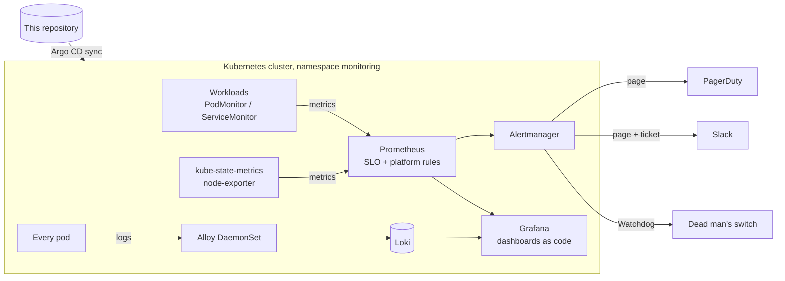

# Kubernetes observability stack: metrics, logs, SLO alerts

[](https://github.com/muhammad-31/k8s-observability-stack/actions/workflows/ci.yml)


[](LICENSE)

A production-style monitoring setup for Kubernetes, where everything beyond the
upstream Helm charts is code with tests: alert rules, Alertmanager routing, the
log pipeline and the dashboards. It answers three questions:

- **Are users affected?** SLO-based paging on error-budget burn rate, not on CPU graphs.
- **Who gets woken up, and how?** Routing that is unit-tested, with a runbook linked from every alert.
- **What happened?** Metrics and logs side by side in Grafana, with no hand-made dashboards.

## Architecture



| Component | Source | Role |
|---|---|---|
| kube-prometheus-stack | `prometheus-community` chart | Prometheus Operator, Prometheus, Alertmanager, Grafana, node-exporter, kube-state-metrics |
| Loki | `grafana-community` chart, Monolithic mode | Log storage (filesystem in dev, S3 in prod) |
| Alloy | `grafana` chart, DaemonSet | Ships every pod's logs to Loki, adds namespace/pod/app/level labels |
| This repository | Kustomize | Alert rules, Alertmanager routing, dashboards, monitors, Alloy pipeline |

## Alerts

| Alert | Severity | Fires when | Runbook |
|---|---|---|---|
| `ErrorBudgetBurnFast` | page | 1h **and** 5m error ratio > 14.4x budget, or 6h **and** 30m > 6x | [ErrorBudgetBurn](runbooks/ErrorBudgetBurn.md) |
| `ErrorBudgetBurnSlow` | ticket | 1d **and** 2h > 3x, or 3d **and** 6h > 1x | [ErrorBudgetBurn](runbooks/ErrorBudgetBurn.md) |
| `ContainerOOMKilled` | warning | a container restarted after hitting its memory limit | [ContainerOOMKilled](runbooks/ContainerOOMKilled.md) |
| `CertificateExpiringSoon` | warning | a cert-manager certificate is < 14 days from expiry | [CertificateExpiringSoon](runbooks/CertificateExpiringSoon.md) |
| `CertificateNotReady` | warning | issuance/renewal failing for 30 min | [CertificateExpiringSoon](runbooks/CertificateExpiringSoon.md) |
| `ArgoCDAppDegraded` | critical | an Argo CD application is Degraded for 10 min | [ArgoCDApp](runbooks/ArgoCDApp.md) |
| `ArgoCDAppOutOfSync` | warning | cluster differs from Git for 30 min | [ArgoCDApp](runbooks/ArgoCDApp.md) |
| `KyvernoPolicyViolations` | ticket | resources fail a Kyverno policy | [KyvernoPolicyViolations](runbooks/KyvernoPolicyViolations.md) |

These come on top of the ~150 default alerts kube-prometheus-stack ships (with control-plane scraping disabled for managed clusters).

### Why burn-rate alerts

The SLO is 99.9% of HTTP requests succeeding over 30 days, which is an error
budget of 0.1%. Paging on "error rate > 1%" either pages for blips or misses
slow leaks. Burn-rate alerts page on how fast the budget is being spent, and
each needs a long *and* a short window to agree: the long window proves it is
significant, and the short window makes the alert stop soon after the problem
is fixed. A unit test covers exactly that: a 10-minute outage pages, and the
page has cleared 40 minutes after recovery.

### Routing

| Alert | Goes to |
|---|---|
| `severity=page` or `critical` | PagerDuty **and** #incidents |
| `severity=ticket` or `warning` | #alerts |
| `Watchdog` | dead man's switch (you get alerted if alerting itself breaks) |
| `severity=info` | dropped |

A page silences the matching ticket for the same namespace (inhibition), so the
same incident does not notify twice.

## Tested like code

```bash
make validate
```

| Check | Tool |
|---|---|
| Rule syntax + **9 unit-test scenarios (16 assertions)** with synthetic time series | `promtool check rules`, `promtool test rules` |
| Alertmanager config + **8 routing assertions** | `amtool check-config`, `amtool config routes test` |
| Log pipeline syntax and component wiring | `alloy fmt`, `alloy validate` |
| Dashboards: JSON, unique UIDs, no hard-coded datasources, grid layout, every PromQL query parses | `hack/lint-dashboards.py` + `promtool` |
| Dashboards in Git match their generator | `hack/generate-dashboards.py` + `git diff` |
| All three charts (dev and prod values) + Kustomize output against Kubernetes 1.35 and CRD schemas | `helm template`, `kubeconform` |

## Repository layout

```text
.
├── values/                 # Helm values per chart, plus *-prod.yaml overrides
├── rules/                  # PrometheusRule CRs (SLO + platform) and promtool tests
├── alertmanager/           # routing config (no credentials)
├── alloy/config.alloy      # log pipeline
├── dashboards/             # generated Grafana JSON (SLO overview, workload overview)
├── monitors/               # PodMonitor for the sample app
├── runbooks/               # one page per alert, linked from the alert itself
├── argocd/                 # ApplicationSet + config Application, dev and prod
├── examples/               # ExternalSecret manifests for the two required Secrets
├── hack/                   # validate.sh, test scripts, dashboard generator and linter
└── kustomization.yaml      # everything this repo adds on top of the charts
```

## Deploying

**Secrets first.** Two Secrets in `monitoring` are expected and never stored in Git:

| Secret | Keys |
|---|---|
| `grafana-admin` | `admin-user`, `admin-password` |
| `alertmanager-receivers` | `slack-webhook-url`, `pagerduty-routing-key`, `deadmans-switch-url` |

Create them with the External Secrets Operator ([example](examples/external-secrets.yaml))
or with `kubectl`. `make secrets` creates throwaway ones for a demo.

**With Argo CD:**

```bash
kubectl apply -f argocd/observability-dev.yaml
```

**Locally on kind, without Argo CD:**

```bash
make up        # kind cluster, demo secrets, the three charts, then this repo's config
make grafana   # http://localhost:3000; dashboards are in the "SLOs" and "Kubernetes" folders
```

## Works with gitops-argocd-platform

The [GitOps platform repo](https://github.com/muhammad-31/gitops-argocd-platform)
runs podinfo, cert-manager, Kyverno and Argo CD. This stack scrapes podinfo
through `monitors/podinfo.yaml`, and the platform alerts above cover the other
three. To deploy it from that repo's Argo CD, add this repository and the three
chart repositories to its `platform` AppProject and allow the `monitoring`
namespace.

## Design decisions

- **Alloy, not Promtail.** Promtail reached end of life in March 2026; Alloy is its successor and can also take over metrics and traces later.
- **Loki from `grafana-community`.** The Loki Helm chart moved to the community repository in March 2026.
- **Monolithic Loki.** A single binary handles a few tens of GB of logs a day. Simple-scalable mode is deprecated and microservices mode only pays off at much larger volumes.
- **Recording and alerting SLO rules in one group.** Rules in a group run in order, so alerts always read the ratios from the same evaluation. With separate groups the two race, which also made the unit tests flaky.
- **Credentials only in mounted files.** Receivers use `api_url_file` / `routing_key_file`, so the full Alertmanager config is safe to keep in Git and test in CI.
- **Dashboards generated from Python.** Every panel in a dashboard is built the same way, the diffs are reviewable, and CI rejects JSON that has drifted from the generator.

## License

[MIT](LICENSE)
